<a href="https://hafizsyq.vercel.app">
  
</a>

<h1 align="center">hafiz-syq</h1>

<p align="center">
  <strong>Web Developer</strong> · self-taught, 2022 · Aceh, Indonesia
</p>

<p align="center">
  <a href="https://hafizsyq.vercel.app">portfolio</a> ·
  <a href="mailto:hafizsyq@gmail.com">mail</a> ·
  <a href="https://wa.me/6283127596144">whatsapp</a> ·
  <a href="https://github.com/hafiz-syq?tab=repositories">repos</a>
</p>

---

```console
$ whoami
hafiz-syq

$ uname -a
self-taught · since 2022 · Aceh, Indonesia

$ ls ~/work
bem-ft-unaya  ParanoidClicker  EduVerse  Invitara  MyPortofolio

$ cat ~/stack
react · vite · tailwind — node · express · prisma — mysql · postgresql
```

I build web apps that a real organisation has to keep running. Every line below links to
code or to a URL you can open, because that is the only part worth claiming.

**Bahasa Indonesia** — Saya membangun aplikasi web yang benar-benar dipakai organisasi,
bukan portofolio latihan. TypeScript dan React di sisi klien, Node.js + Express + Prisma di
sisi server, MySQL dan PostgreSQL di bawahnya. Tiga project punya tautan aktif.

---

## Selected work

### [bem-ft-unaya](https://github.com/hafiz-syq/bem-ft-unaya) · [live](https://bem-ft-unaya.vercel.app)

Aspiration and complaint desk for a whole faculty. Route-level role-based access, generated
ticket numbers, web-push notifications and MySQL retention jobs, guarded by an automated
access-matrix test suite; an Android build runs in CI next to the web deploy.

`React` `Vite` `Tailwind` `Express` `Prisma` `MySQL` `GitHub Actions`

### [ParanoidClicker](https://github.com/hafiz-syq/ParanoidClicker)

Keeps a band in sync over one shared session. A Cloudflare Durable Object hosts the realtime
clock, so every phone locks to the same beat instead of drifting apart.

`TypeScript` `React` `Vite` `Cloudflare Workers` `Durable Objects` `Vitest`

### [EduVerse](https://github.com/hafiz-syq/EduVerse) · [live](https://eduverselearn.vercel.app)

Free programming-learning platform. Vite + React, a shadcn/ui component layer, an in-browser
CodeMirror editor, PostgreSQL storage.

`React` `TypeScript` `Vite` `Tailwind` `shadcn/ui` `PostgreSQL`

### [Invitara](https://github.com/hafiz-syq/Invitara)

Digital invitation platform in plain PHP against a MySQL schema, packaged with Composer,
MIT-licensed. Written before the typed stack.

`PHP` `MySQL` `JavaScript` `CSS`

Source of the portfolio above: [MyPortofolio](https://github.com/hafiz-syq/MyPortofolio).

## Toolbox

<table>
  <tr>
    <td width="130"><strong>languages</strong></td>
    <td></td>
  </tr>
  <tr>
    <td><strong>front end</strong></td>
    <td></td>
  </tr>
  <tr>
    <td><strong>back end</strong></td>
    <td></td>
  </tr>
  <tr>
    <td><strong>data</strong></td>
    <td></td>
  </tr>
  <tr>
    <td><strong>platform</strong></td>
    <td></td>
  </tr>
</table>

## Signal

<p align="center">
  
  
</p>

Rebuilt on a schedule by GitHub Actions in this repository — never updated by hand.

<details>
<summary>noise in the signal</summary>

<p align="center">
  <picture>
    <source media="(prefers-color-scheme: dark)" srcset="https://raw.githubusercontent.com/hafiz-syq/hafiz-syq/pacman-output/bomberman-contribution-graph-dark.svg?game=bomberman">
    <source media="(prefers-color-scheme: light)" srcset="https://raw.githubusercontent.com/hafiz-syq/hafiz-syq/pacman-output/bomberman-contribution-graph.svg?game=bomberman">
    
  </picture>
</p>

<p align="center">
  <a href="https://open.spotify.com/user/31hubkehvnifdjppd3pcpwmslyli">
    
  </a>
</p>

<p align="center">
  <sub><a href="https://open.spotify.com/user/31hubkehvnifdjppd3pcpwmslyli">spotify profile</a> — hidden here on purpose: the link itself shows my real name.</sub>
</p>

</details>
